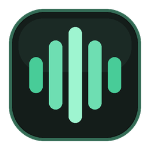

# 🎧 VoicePlayer — Голосовой плеер для разработчиков и ИИ-ассистентов

<p align="center">
  
</p>

<p align="center">
  <b>Бесплатный десктопный голосовой плеер для разработчиков</b><br/>
  Озвучивает ответы от <b>Antigravity</b>, <b>Codex</b>, <b>Claude Code</b> и <b>Cursor</b> живыми нейросетевыми голосами.<br/>
  100% офлайн с Piper TTS (без интернета и API-ключей) + облачный Edge TTS.
</p>

<p align="center">
  <a href="https://github.com/infostroper-cloud/voice-player/releases/latest"></a>
  
  
  <a href="https://t.me/voiceplayer_ai"></a>
</p>

---

## 🌐 Языки документации / Other Languages

* [English](README.md)
* [Русский (Текущий)](README.ru.md)
* [Español](README.es.md)
* [中文](README.zh.md)
* [日本語](README.ja.md)

---

## ✨ Ключевые возможности

- **🤖 Автоперехват диалогов**: Автоматически подтягивает ответы и код из Antigravity, Codex (Desktop и CLI), Claude Code и Cursor через файловые хуки и общую базу.
- **⚡ 100% офлайн-режим**: Встроенный Piper TTS на ONNX работает со скоростью **25× от реального времени** на обычном процессоре. Ваш код и секреты никогда не покидают компьютер.
- **🌍 8 языков интерфейса и автоопределение речи**: Мгновенно переключается на носителей языка для русского, английского, испанского, китайского, японского, хинди, немецкого и французского.
- **📊 Умные таблицы и карточки кода**: Превращает Markdown-таблицы в визуальные карточки с караоке-подсветкой текущей читаемой строки и переходом по клику на любое предложение.
- **⌨️ Глобальный хоткей**: Выделите любой текст на экране (PDF, браузер, терминал) и нажмите `Ctrl+Alt+S` (или `Cmd+Shift+S` на macOS) для мгновенной озвучки.
- **🎤 Голосовой ввод и команды**: Локальная диктовка через Whisper и управление воспроизведением голосом (*пауза, дальше, повтори, быстрее*).

---

## 📦 Установка

### 🪟 Windows (10 / 11)
- **Вариант 1 (Рекомендуемый)**: Скачайте графический установщик:
  👉 **[VoicePlayer-Setup-1.2.0.exe](https://github.com/infostroper-cloud/voice-player/releases/latest/download/VoicePlayer-Setup-1.2.0.exe)**  
  *(Автоматически проверит Python, распакует файлы, закрепит ярлыки и сразу запустит плеер).*
- **Вариант 2 (Портативный)**: Скачайте архив **[VoicePlayer-Installer-1.2.0.zip](https://github.com/infostroper-cloud/voice-player/releases/latest/download/VoicePlayer-Installer-1.2.0.zip)**, распакуйте в любую папку и запустите `Install-VoicePlayer.cmd`.

### 🍎 macOS и 🐧 Linux
Выполните одну команду в терминале:
```bash
curl -fsSL https://raw.githubusercontent.com/infostroper-cloud/voice-player/main/install.sh | bash
```

---

## 💚 Честная модель Supporter и статус Supporter Pro

VoicePlayer **полностью бесплатен** для каждого пользователя, без урезания функций и без назойливой рекламы.

Если VoicePlayer экономит ваше время и зрение, вы можете поддержать независимого автора и получить пожизненный бейдж **Supporter (★ Pro)**:
- **Telegram (Tribute)**: [Поддержать / Получить ключ Pro](https://t.me/tribute/app?startapp=dTZW)
- **Boosty**: [Купить ключ на Boosty](https://boosty.to/tikoulf/posts/2b4dd6a8-157f-4202-b8db-b4e019ae8a02)
- **Официальный Telegram-канал и поддержка**: [@voiceplayer_ai](https://t.me/voiceplayer_ai)
